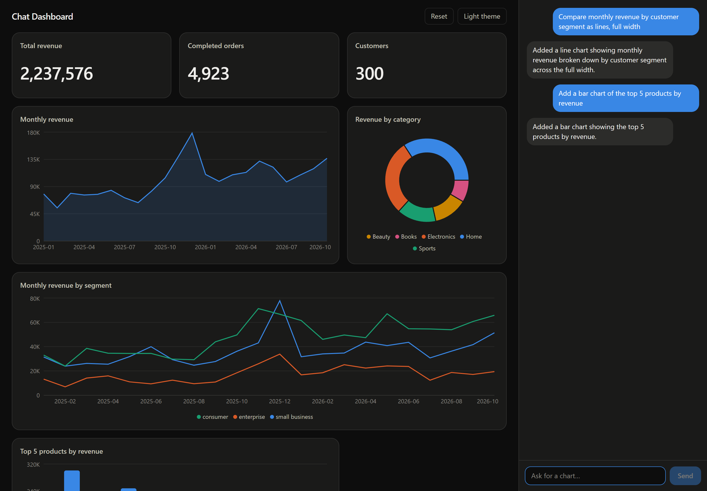
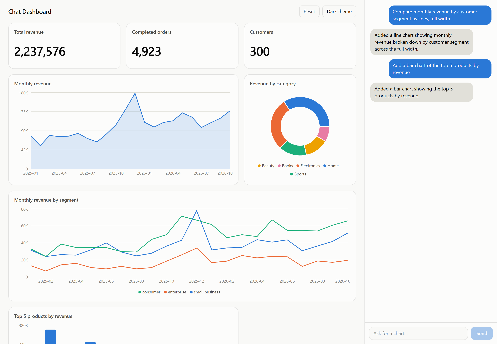

# Chat Dashboard

A dashboard you customize by talking to it. Ask for a chart in plain language; the assistant turns the request into a SQL query, runs it against the database, and adds, edits, or removes widgets.

> "Compare monthly revenue by customer segment as lines" · "Turn the pie into bars" · "Remove the customers widget"



<details>
<summary>Light theme</summary>



</details>

## Quick start

Requires Node.js 22.18 or newer and a free [Groq API key](https://console.groq.com/keys).

```bash
npm install
cp .env.example .env.local   # then set GROQ_API_KEY
npm run dev
```

Open http://localhost:3000. The demo database (a small e-commerce dataset in SQLite) is generated on first run; `npm run seed -- --force` rebuilds it.

## How it works

```
Browser                              Next.js route handlers
┌───────────────┬─────────┐
│ Widget grid   │  Chat   │  POST /api/chat   schema + current widgets + message → LLM
│ (Recharts)    │         │                   ← { reply, actions } → validated → SQL executed
└───────────────┴─────────┘  POST /api/query  re-runs a saved widget's SQL on page load
```

A widget is a small JSON spec, not generated code:

```ts
type Widget = {
  id: string; title: string;
  chart: "bar" | "line" | "area" | "pie" | "kpi" | "table";
  sql: string;             // SELECT that produces the data
  x: string; y: string[];  // result columns to plot
  span: 1 | 2 | 3;         // width in grid columns
};
```

The model answers in JSON mode with a list of `add` / `update` / `remove` actions. The server validates them, runs the SQL, and checks that the mapped columns exist. If anything fails, the error is sent back to the model for one retry. The dashboard layout is saved in the browser's `localStorage`.

| Path | Role |
|---|---|
| `lib/db.ts` | Read-only SQLite access and schema description for the prompt |
| `lib/llm.ts` | Groq call (OpenAI-compatible API) and system prompt |
| `lib/widgets.ts` | Widget type, validation of model output, default dashboard |
| `app/api/` | `chat` and `query` endpoints |
| `components/` | Widget card with charts, chat panel |
| `scripts/seed.mjs` | Demo database generator |

## Safety

The SQL is written by an LLM and, for saved widgets, sent back by the browser, so it is treated as untrusted:

- the SQLite connection is opened **read-only**;
- only a single `SELECT` / `WITH` statement runs per request;
- results are capped at 1,000 rows.

There is no authentication, rate limiting, or query timeout. Run it locally or behind your own auth; do not expose it to the internet as is.

## Configuration

| Variable | Default | |
|---|---|---|
| `GROQ_API_KEY` | (required) | Groq API key |
| `GROQ_MODEL` | `openai/gpt-oss-120b` | Any Groq chat model that supports JSON mode |

To use your own data, point `lib/db.ts` at another SQLite file and adjust the domain hint in `lib/llm.ts`.

## Tests

```bash
npm test
```

## License

[MIT](LICENSE)
